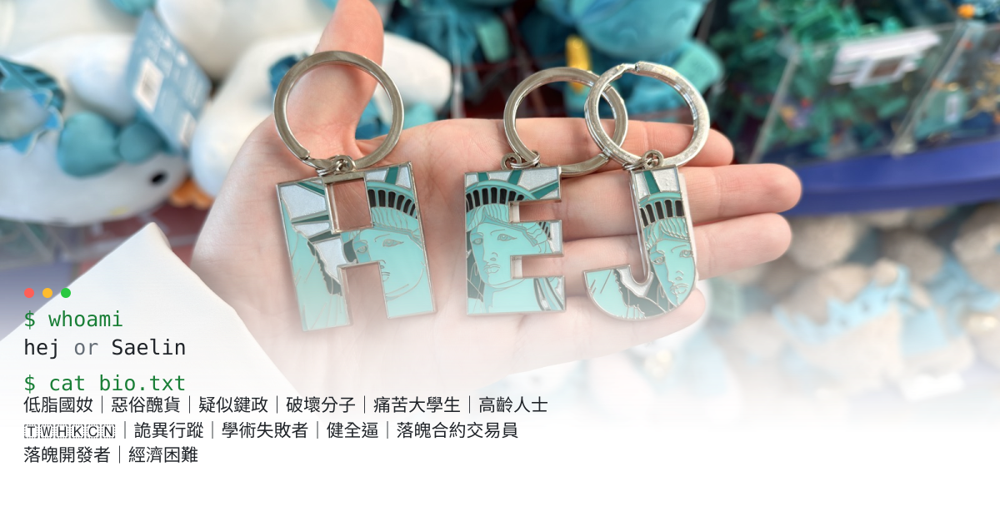
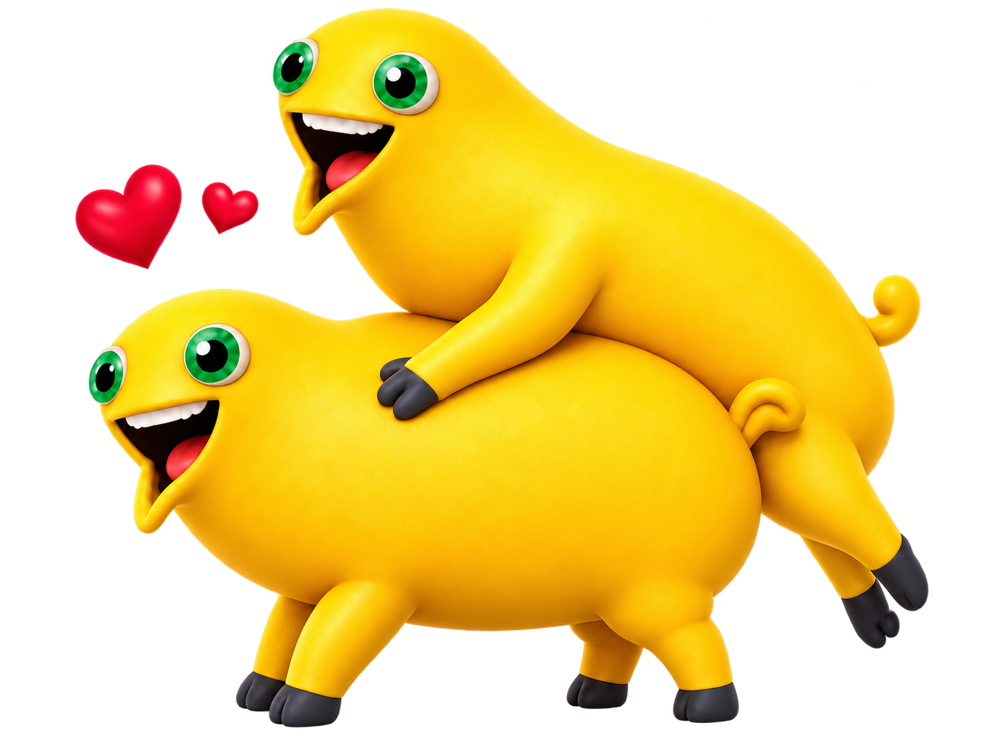
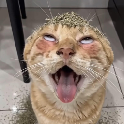

<picture>
  <source media="(max-width: 600px)" srcset="assets/hero-mobile.svg" />
  
</picture>

### Latest project

<table>
<tr>
<td width="110" align="center" valign="middle">

</td>
<td valign="middle">
<strong><a href="https://github.com/liyouran0820/nailong-university-domains">奶龍大學 · 高校域名合集</a></strong> 
致力於建設全球最大的奶龍學術平台，匯聚海內外頂尖奶龍高校。 
立足奶龍，面向世界。為「誰才是奶龍」提供一站式研究入口。 
高校域名導航 · 奶龍／奶蛙／奶蛋 · PRs Welcome
</td>
</tr>
<tr>
<td width="110" align="center">

</td>
<td>
<strong><a href="https://github.com/Hej28/Hejs-Pets">Hej’s Pets</a></strong> 
把照片變成在 Mac 的 Dock 和螢幕邊緣爬行的小寵物。 
拖拽、跳躍、表情和自訂氣泡；照片與寵物資料留在本機。 
Swift · AppKit · Core Image · Vision
</td>
</tr>
</table>

### Languages &amp; Tools

  
  
  
  
  
  

  
  
  
  
  

### Pinned

<table>
<tr>
<td width="50%" valign="top">
<strong><a href="https://github.com/liyouran0820/von-neumann-dreams">午夜學院 · 夜白映射</a></strong>  
AI 開發馬拉松的團隊專案。以雙世界切換與空間映射為核心的解謎遊戲，正在推進 Godot 原生版本。  
Godot · GDScript · JavaScript · Three.js
</td>
<td width="50%" valign="top">
<strong><a href="https://github.com/Hej28/Hejs-Pets">Hej’s Pets</a></strong>  
一個輕量的原生 macOS 桌面寵物小玩具。把喜歡的照片變成能拖拽、會亂跑的小傢伙。  
Swift · macOS
</td>
</tr>
</table>
