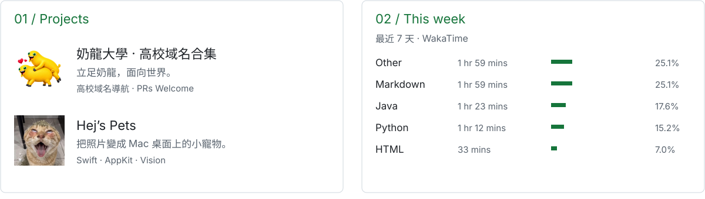
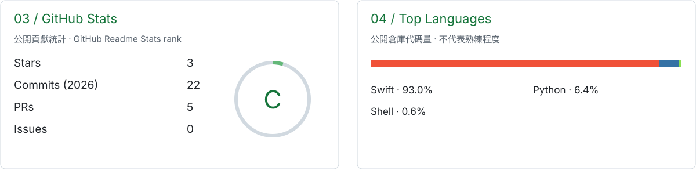
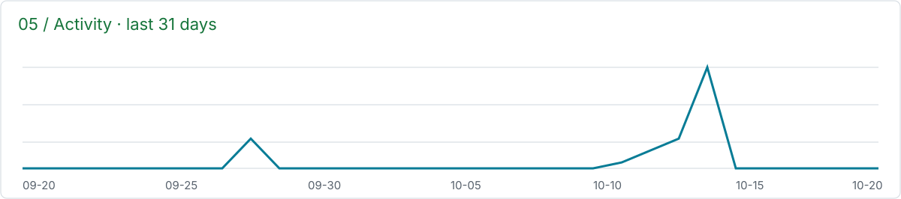

<picture>
  <source media="(max-width: 600px)" srcset="assets/dashboard/hero-mobile.svg" />
  
</picture>

<picture>
  <source media="(max-width: 600px)" srcset="assets/dashboard/overview-mobile.svg" />
  
</picture>

[奶龍大學 · 高校域名合集](https://github.com/liyouran0820/nailong-university-domains) · [Hej’s Pets](https://github.com/Hej28/Hejs-Pets)

<picture>
  <source media="(max-width: 600px)" srcset="assets/dashboard/stats-mobile.svg" />
  
</picture>

<picture>
  <source media="(max-width: 600px)" srcset="assets/dashboard/activity-mobile.svg" />
  
</picture>

### Languages &amp; Tools

  
  
  
  
  
  

  
  
  
  
  

### Pinned

<table>
<tr>
<td width="50%" valign="top">
<strong><a href="https://github.com/liyouran0820/von-neumann-dreams">午夜學院 · 夜白映射</a></strong>  
AI 開發馬拉松的團隊專案。以雙世界切換與空間映射為核心的解謎遊戲，正在推進 Godot 原生版本。  
Godot · GDScript · JavaScript · Three.js
</td>
<td width="50%" valign="top">
<strong><a href="https://github.com/Hej28/Hejs-Pets">Hej’s Pets</a></strong>  
一個輕量的原生 macOS 桌面寵物小玩具。把喜歡的照片變成能拖拽、會亂跑的小傢伙。  
Swift · macOS
</td>
</tr>
</table>

統計每 6 小時自動更新。GitHub 評級採用 github-readme-stats 的貢獻算法；語言占比反映公開自有倉庫的代碼量。編碼時間需連接 WakaTime，從啟用後開始記錄。
