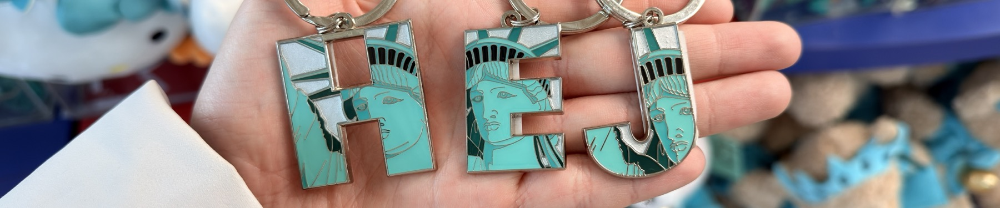
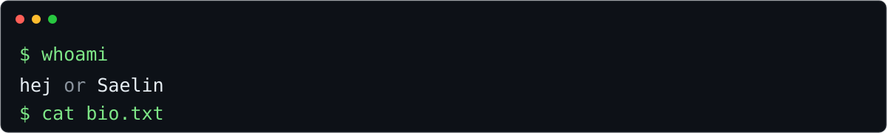

  

<picture>
  <source media="(max-width: 600px)" srcset="assets/terminal-mobile.svg" />
  
</picture>

<blockquote>

<samp>低脂國奻｜惡俗醜貨｜疑似鍵政｜破壞分子｜痛苦大學生｜高齡人士 
🇹🇼🇭🇰🇨🇳｜詭異行蹤｜學術失敗者｜健全逼｜落魄合約交易員 
落魄開發者｜經濟困難</samp>

</blockquote>

### Latest project

<table>
<tr>
<td width="110" align="center">

</td>
<td>
<strong><a href="https://github.com/Hej28/Hejs-Pets">Hej’s Pets</a></strong> 
把照片變成在 Mac 的 Dock 和螢幕邊緣爬行的小寵物。 
拖拽、跳躍、表情和自訂氣泡；照片與寵物資料留在本機。 
Swift · AppKit · Core Image · Vision
</td>
</tr>
</table>

### Languages &amp; Tools

  
  
  
  

  
  
  
  

### Pinned

<table>
<tr>
<td width="50%" valign="top">
<strong><a href="https://github.com/liyouran0820/von-neumann-dreams">午夜學院 · 夜白映射</a></strong>  
AI 開發馬拉松的團隊專案。以雙世界切換與空間映射為核心的解謎遊戲，正在推進 Godot 原生版本。  
Godot · GDScript · JavaScript · Three.js
</td>
<td width="50%" valign="top">
<strong><a href="https://github.com/Hej28/Hejs-Pets">Hej’s Pets</a></strong>  
一個輕量的原生 macOS 桌面寵物小玩具。把喜歡的照片變成能拖拽、會亂跑的小傢伙。  
Swift · macOS
</td>
</tr>
</table>
